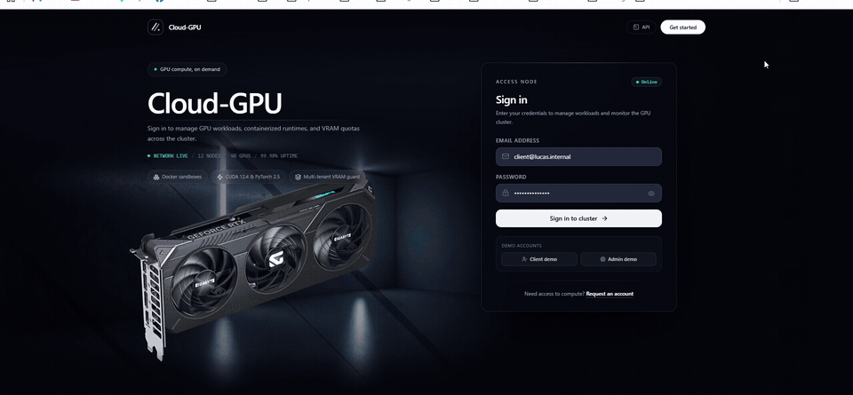

# Cloud-GPU: a simple guide

This guide is for people who want to run a project without needing to understand
computer hardware or software setup.

## What is Cloud-GPU?

Cloud-GPU is a website where you can upload a small program, ask the computer to
run it, and check how it is doing. A **job** simply means one run of your
program. The administrator sets up the service and gives you an account.

## Watch the quick tour

The animation shows how to sign in, view the dashboard, and open the job setup
page. It stops before submitting a job.

## Run a project

1. **Sign in** with the account provided by your administrator.
2. **Check the overview.** It shows whether the computer and GPU are available.
3. Select **Create Job**.
4. Choose the option that matches your project:
   - **Python (CPU):** ordinary Python programs.
   - **Python / PyTorch (GPU):** projects that use an NVIDIA GPU, often for AI.
   - **CUDA C/C++:** programs specifically written for NVIDIA GPUs.
5. **Upload your project** or a ZIP file containing it. If asked, choose the
   main file that starts the program.
6. Select **Submit Job**.
7. Open **My Jobs** to follow its progress. When it finishes, open the job to
   view its logs and available results.

## What the status means

| Status | In plain language |
| --- | --- |
| **Queued** | The request is waiting for a free slot. You usually do not need to submit it again. |
| **Running** | The computer is working on your project. |
| **Succeeded** | The program finished normally. Open the job to see its results. |
| **Failed** | Something stopped the program. Open the job logs and ask your administrator for help. |
| **Cancelled** | The job was stopped by you or an administrator. |

## A few helpful terms

- **GPU:** a part of the computer that can speed up certain kinds of work.
- **Credits:** the service's usage balance. They are not money.
- **Logs:** a simple record of what happened while your program ran.

## Keep your information safe

- Upload only projects you trust and are allowed to use.
- Do not put passwords, API keys, or private documents in uploaded files.
- Do not share your sign-in details with other people.

If a job stays queued for a long time or fails, open its details and contact your
administrator. They can check the available hardware and the job logs.
